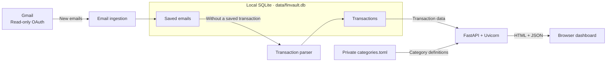
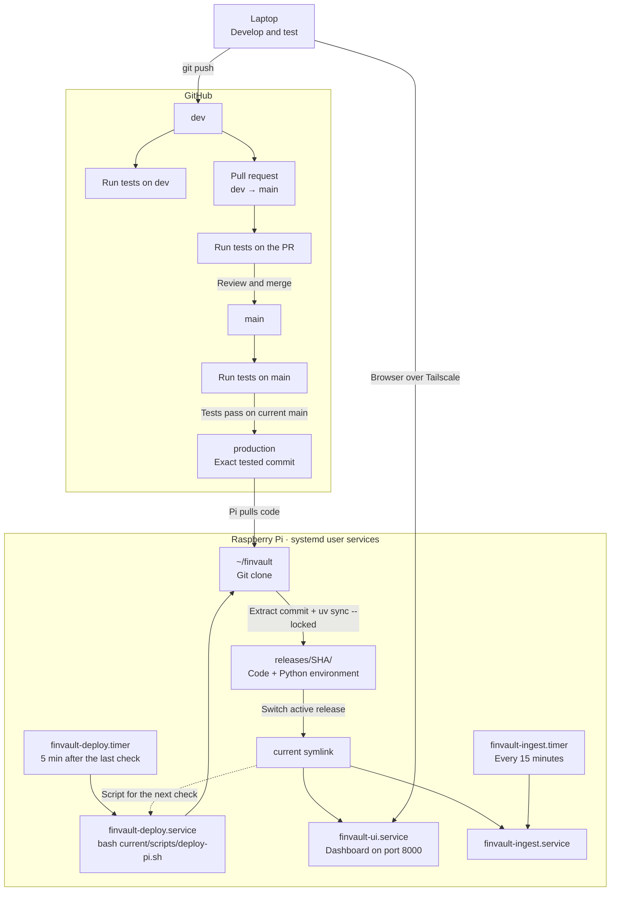

# FinVault

Self-hosted personal finance tracker powered by Gmail transaction emails.

The public website and GitHub Pages publishing instructions are in [docs/](docs/README.md).

## Architecture



Emails with saved transactions are not reparsed; failed or unsupported emails
remain eligible for a later attempt.

## Local testing

Run these commands from the repository root. Install dependencies first:

```bash
uv sync --locked
```

Run Gmail ingestion and transaction processing (`src/finvault/__main__.py`).
Place your Google OAuth `credentials.json` in the repository root; the first run
opens a browser for authorization and saves `token.json`.

```bash
uv run --locked python -m finvault
```

Start the UI server (`src/finvault/api/main.py`):

```bash
uv run --locked uvicorn finvault.api.main:app --host 0.0.0.0 --reload
```

On the same machine, open <http://127.0.0.1:8000/>. From another machine over
Tailscale, open `http://<server-tailscale-ip>:8000/`. The server listens on all
IPv4 interfaces, including the LAN. Both commands use `data/finvault.db`.

## Categories

Open **Settings** to add categories and keyword rules, then select **Save changes**.
Rules look for keywords in email bodies, ignoring capitalisation. The first
matching rule wins. New transactions are categorised automatically.

Your private settings are saved in `categories.toml`:

- Laptop: project root.
- Pi: `~/.local/share/finvault/categories.toml`.

The file stays out of Git. Laptop and Pi settings are separate.

In Settings, select **Preview**, then **Apply** to categorise existing
Uncategorized transactions. Leave the month blank for all data, or select a month.
These buttons use the server hosting the page and keep existing assignments.

Alternatively, use the terminal. On the laptop, run from the project root:

```bash
uv run --locked python -m finvault.backfill_categories --month 2026-10
```

On the Pi:

```bash
cd "$HOME/.local/share/finvault" &&
"$HOME/.local/share/finvault/current/.venv/bin/python" \
  -m finvault.backfill_categories --month 2026-10
```

Add `--apply` after reviewing; omit `--month` for all months. Existing category
assignments are kept. Settings has copyable preview and apply commands for both
the laptop and Pi next to the rules.

## Tests and CI

Run the unit tests locally:

```bash
uv run --locked python -m unittest discover -s tests -v
```

Run dashboard and settings interaction tests with Node.js (no npm install needed):

```bash
node --test tests/*.test.cjs
```

[GitHub Actions CI](.github/workflows/ci.yml) runs the same tests on pushes and
pull requests, and can be started manually from the Actions tab. It uses the
Python version in `.python-version` and the dependencies in `uv.lock`. Tests use
synthetic data and mocked Gmail access; no Google credentials or repository
secrets are required.

## Development workflow

Develop, test, and commit code changes on `dev`, then push:

```bash
git switch dev
git push origin dev
```

When ready to release, open a pull request on GitHub with **base: `main`** and
**compare: `dev`**. Review the test results, then merge the PR.

Pushes to `dev` and pull requests run tests without deploying. After a merge,
CI tests `main` again and promotes its passing commit to `production`. The Pi
deploys it on the next update check. CI maintains the `production` branch.

## Deployment architecture



Releases and `current` live under `~/.local/share/finvault/`. The database,
OAuth files, and logs stay outside the release directories.

Unchanged commits skip deployment. Updates wait for ingestion to finish, restart
the UI, and check startup; failed startup triggers a rollback to the previous
code. Database changes are not rolled back.

See the [Pi deployment guide](deploy/README.md) for setup commands.

## License

FinVault is available under the [MIT License](LICENSE). You may use, modify,
and redistribute it, including commercially, provided the copyright and license
notices are retained in copies or substantial portions of the software.

Contact: [anandvgeorge@gmail.com](mailto:anandvgeorge@gmail.com).
